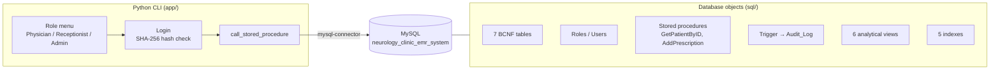
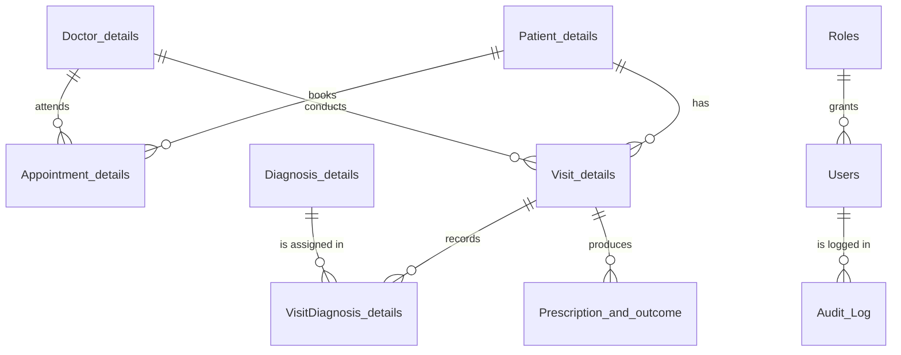
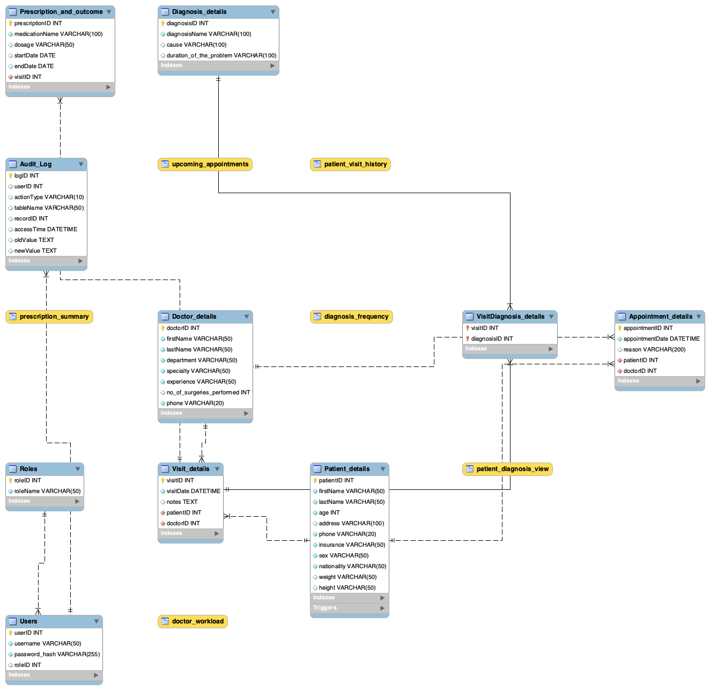
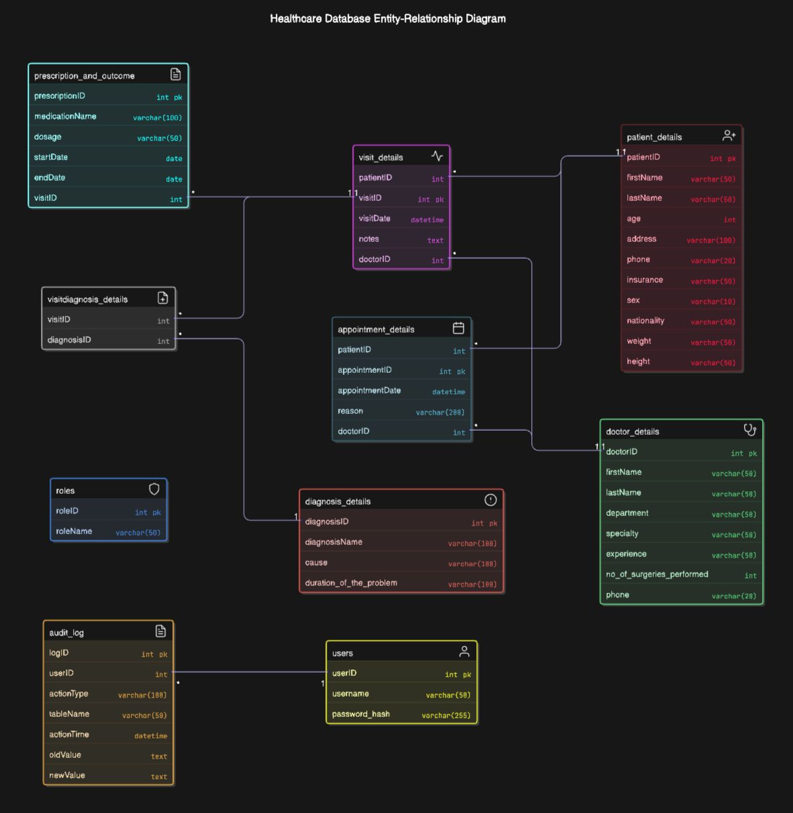

# Neurology Clinic EMR Database

A normalized (BCNF) **MySQL** database for an outpatient neurology clinic, with a role-based **Python** command-line interface, stored procedures, an audit-log trigger, analytical views and performance indexes.


## Problem

Small specialty clinics often track patients, appointments, diagnoses and prescriptions in spreadsheets or paper charts. That makes it hard to answer basic questions ("Which patients saw Dr. X last month?", "What is our most frequent diagnosis?") and gives no record of who changed a patient's data. This project designs the relational backbone of an Electronic Medical Record (EMR) system that solves both problems.

## Architecture



### Data model



## Tech stack

| Layer | Tools |
|---|---|
| Database | MySQL 8, MySQL Workbench |
| Modeling | ER diagram, UML class diagram (cardinalities) |
| Interface | Python 3, `mysql-connector-python`, `tabulate`, `python-dotenv` |

## My role

Team project (4 members) for *Applied Databases* at UNC Charlotte. **I contributed across the whole project:** requirements and scope, schema design and normalization to BCNF, the SQL (tables, queries, procedures, views, indexes), the role-based Python interface, and the documentation and presentation.

## Features

- **7 normalized tables**: patients, doctors, appointments, visits, diagnoses, a visit↔diagnosis junction table, and prescriptions/outcomes, with primary keys, foreign keys and `NOT NULL` constraints
- **Role-based access**: `Roles` and `Users` tables; the CLI offers separate Physician, Receptionist and Admin portals
- **Stored procedures** used as the app's API: `GetPatientByID`, `AddPrescription`
- **Auditing**: an `AFTER UPDATE` trigger on `Patient_details` writes old and new values to `Audit_Log`
- **Analytical views**: `Patient_Diagnosis_View`, `Patient_Visit_History`, `Prescription_Summary`, `Diagnosis_Frequency`, `Doctor_Workload`, `Upcoming_Appointments`
- **Query optimization**: indexes on appointment date, visit date, diagnosis name, prescription→visit, and a composite `(doctorID, visitDate)` index

## How to run

**Prerequisites:** MySQL 8 and Python 3.8+.

```bash
# 1. Build the database
mysql -u root -p < sql/01_schema_and_sample_data.sql
mysql -u root -p neurology_clinic_emr_system < sql/02_rbac_procedures_views_indexes.sql

# 2. Configure credentials (never committed)
cd app
cp .env.example .env        # then edit DB_USER / DB_PASSWORD

# 3. Run the CLI
pip install -r requirements.txt
python neuro_emr_app.py
```

You can also open the `.sql` files in MySQL Workbench and run them in order.

## Results

- The schema reaches **BCNF**: every table's attributes depend only on its key, which removes the update anomalies of a flat patient-visit sheet.
- Sample data and the queries in `01_schema_and_sample_data.sql` answer typical clinic questions: visit history per patient, diagnosis frequency, doctor workload and upcoming appointments.
- Indexes target the most common filters (dates, doctor + date, diagnosis name).

## Screenshots

| ER diagram | UML diagram |
|---|---|
|  |  |

## Known limitations

These are documented for transparency; they're the next fixes on the list.

- The CLI's login query expects `Users` columns (`user_id`, `email`, `provider_id`, `active`) that differ from the `Users` table in `02_rbac_procedures_views_indexes.sql` (`userID`, `username`, `password_hash`, `roleID`). The two need to be aligned before login works end to end.
- `prescribe_medication()` passes 7 arguments, but `AddPrescription` takes 6.
- The sample `Users` rows hold placeholder strings, not SHA-256 hashes.
- The Admin menu shows "9. Log Out", but the handler checks for `3`.

## Repo structure

```
.
├── sql/
│   ├── 01_schema_and_sample_data.sql      # database, 7 tables, sample rows, queries
│   └── 02_rbac_procedures_views_indexes.sql  # roles/users, procedures, trigger, views, indexes
├── app/
│   ├── neuro_emr_app.py   # role-based CLI
│   ├── db_connector.py    # connection + stored-procedure helper
│   ├── utils.py           # table output, password hashing
│   ├── config.py          # reads DB settings from environment
│   ├── .env.example
│   └── requirements.txt
└── docs/                  # ER and UML diagrams
```
